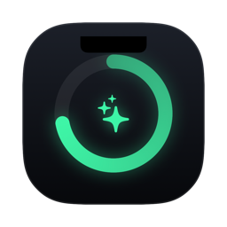
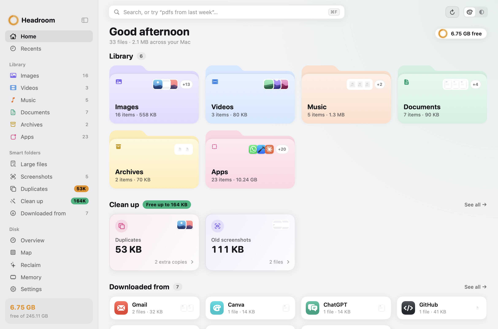
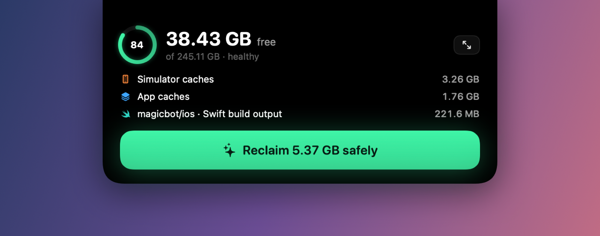
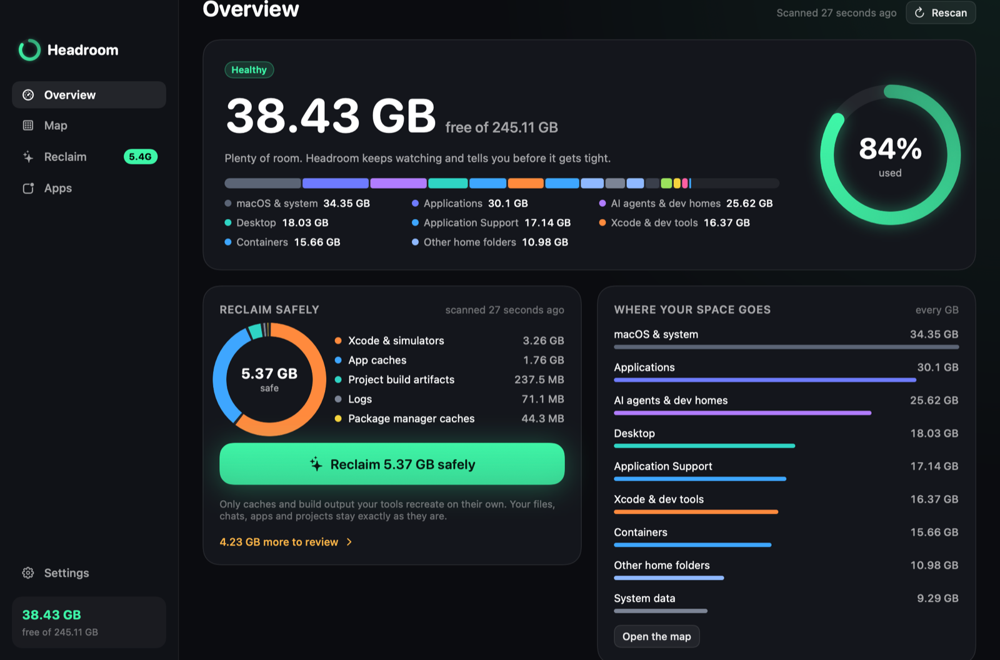
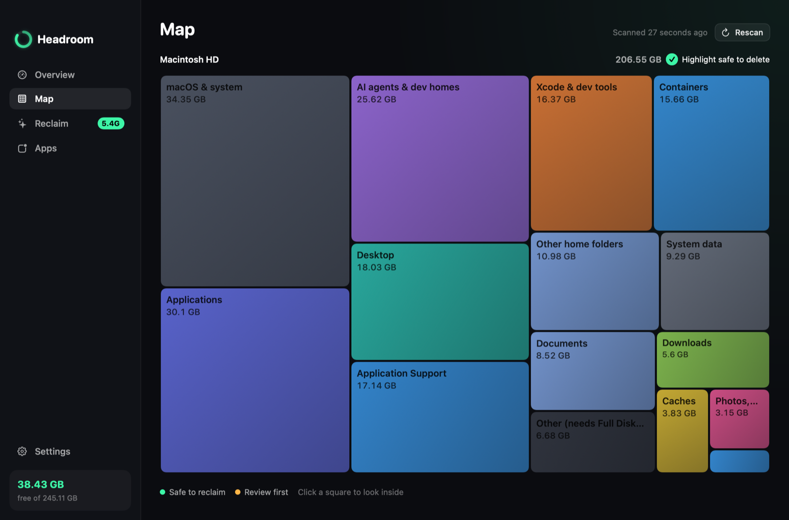
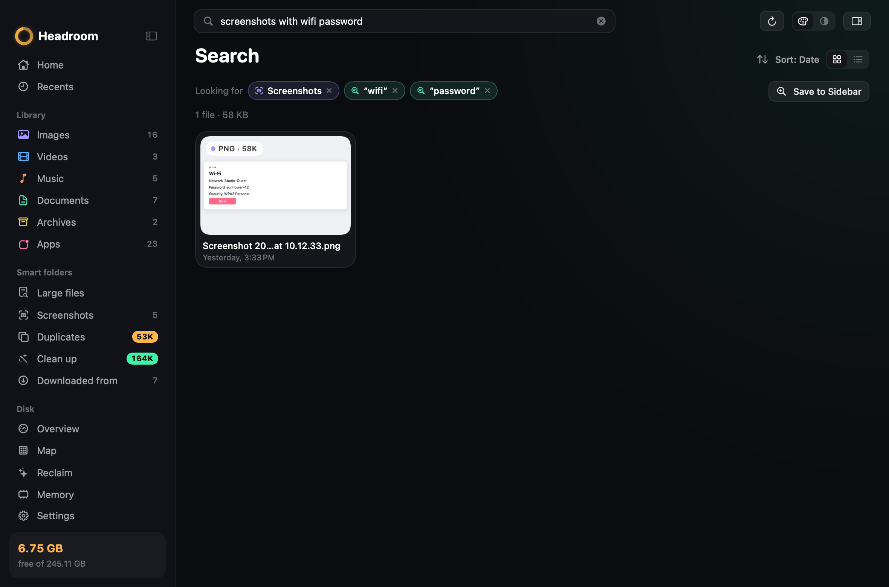
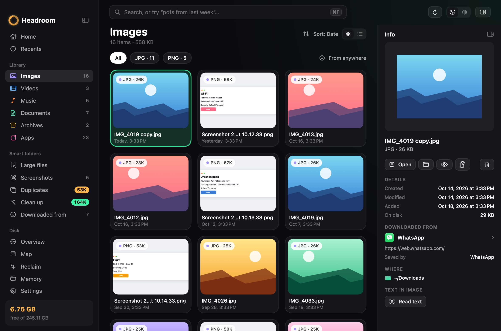
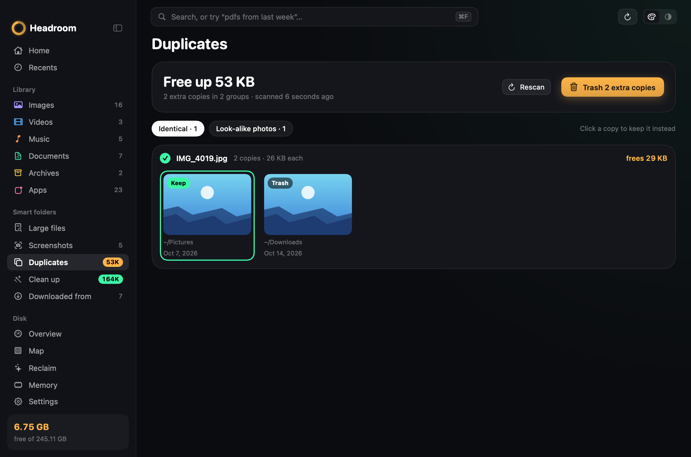
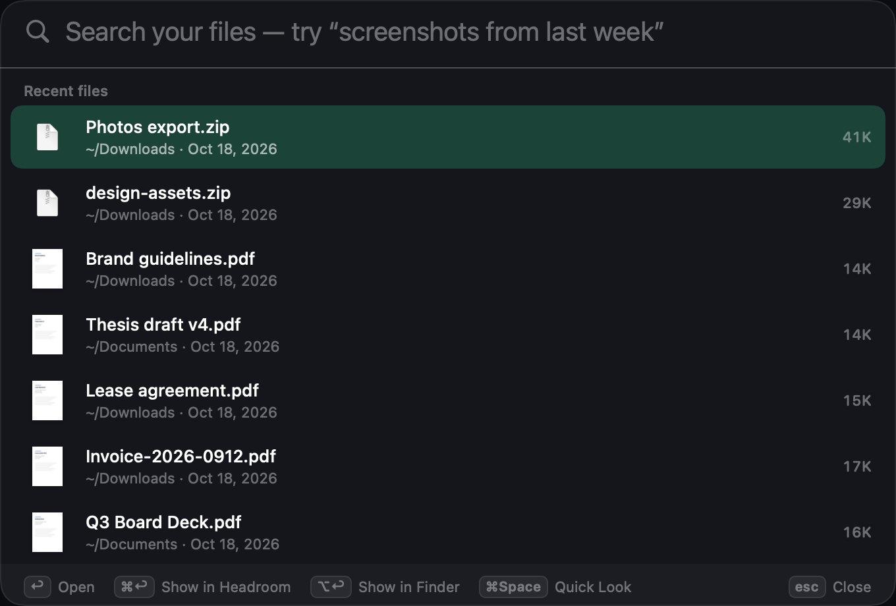
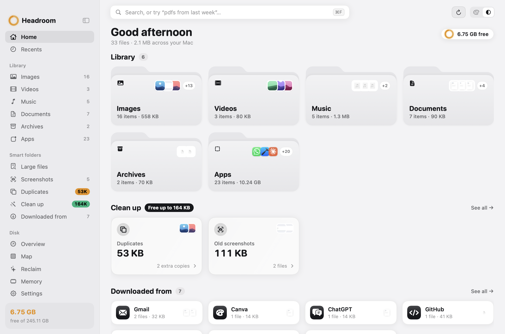

<p align="center"></p>

# Headroom

**Your Mac's storage, in the notch — and your files, finally easy to see.** Headroom shows how
much space you have left right around the camera notch, maps every GB on the disk, and gets
space back in one click — without losing anything you made. Its file library gives every photo,
video, song, document, archive and app a shelf with big thumbnails, and a search that understands
plain English.

Built for Macs that fill up from agentic coding: every repo an agent touches grows its own
`node_modules`, `.next`, `target` or virtualenv, and package caches, simulators and browser
engines pile up behind them.









## What it does

### Your files

- **Home** — a shelf for each kind of file (Images, Videos, Music, Documents, Archives, Apps) with
  the newest ones on it, what you could clean up, where your downloads came from, and your
  recent photos, videos, documents and music.
- **Workspaces** (⌃1–⌃9, ⌥⌘N for a new one) — one project on one page: folders and files from
  anywhere (home, iCloud Drive, Dropbox or Google Drive, an external drive) gathered by reference,
  with each folder's size, file count and last change, and a “Changed lately” strip of the newest
  files across all of them. Nothing is copied or moved. Drag things onto the page or a sidebar row,
  or right-click › Add to Workspace; renamed or moved folders are followed.
- **Search that understands you** — type it the way you'd say it: “pdfs from last week over 5 mb”,
  “videos from my iphone in august”, “zips bigger than 1gb older than 6 months”, “pdfs from gmail”.
  Headroom shows how it read you as chips (type, date, size, source, folder, words) — take one off
  with its ✕. Matches names, tags, the text inside documents (Spotlight) and the text in images.
  Save a search to the sidebar and it always shows what matches right now.
- **Text in images** — the words in your screenshots and recent photos are read on your Mac with
  Apple's Vision, so “screenshots with wifi password” finds that one. ⇧⌘C copies the text out of
  images and PDFs; hover a picture for Copy Text.
- **Downloaded from** (⇧⌘J) — every download grouped by where you got it: Gmail, Google Drive,
  ChatGPT, Claude, Canva, X, Slack, WhatsApp, AirDrop, GitHub, browser extensions or any website.
  A “From” filter appears on every shelf, and the inspector shows each file's source.
- **Duplicates** (⇧⌘D) — identical files by SHA-256 fingerprint and look-alike photos (bursts,
  edits, HEIC/JPEG pairs) by Vision feature prints. Headroom picks the copy to keep; click another
  to keep that one. The rest go to the Trash. Files that live only in iCloud are never read.
- **Clean up** (⇧⌘K) — cards for old installers, forgotten downloads, old screenshots, old screen
  recordings, big old videos, Mail attachments you've opened (Mail's own copies — the original stays
  in the email) and apps you don't use, each with a review page: Trash All or Trash Selected. Everything
  goes to the Trash, with Undo.
- **Finder, but nicer** — grid or list (⌃⌘1 / ⌃⌘2), ⌘+ / ⌘− card size, sort by name, date,
  size or kind; Space for the real Quick Look (arrows move, up and down jump a row); ⌘I inspector
  with a live preview, dimensions, duration, camera, download source and the text inside;
  right-click for Open With, Show in Finder, Copy, Copy Path, Pin to Sidebar, Move to Trash;
  drag several files out into Mail, Slack or Figma at once; browse any folder and pin it.
- **Folders that say what's in them** — every folder card and list row shows how many items it holds
  and how big it is, measured in the background (— until known). Group a folder by kind or by date
  added (Today, Yesterday, This Week, Earlier) next to Sort; nothing moves on disk.
- **For developers** — a git project shows its branch and uncommitted changes in the path bar (and on
  its workspace card), read-only: the branch from `.git/HEAD`, changes from `git status`, never a
  fetch or a write. ⌥⇧⌘T opens the folder on screen in your terminal (Ghostty, Warp, iTerm or
  Terminal, whichever is installed first), ⌥⇧⌘E in your editor (VS Code, Cursor, Zed, Xcode, Sublime
  Text, Nova, BBEdit or a JetBrains IDE — pick in Settings); both are in a folder's right-click menu.
- **Quick Search** (⌃⌥Space, from any app) — a Raycast-style command bar: files, apps, System Settings
  pages ("wifi", "dark mode"), Headroom's screens and commands, and sums (`1920 * 1.25`) in one ranked
  list that learns what you open. ↩ opens,
  ⌘K lists every action (Open With, Copy Path, Quick Look…) each with its own key, ⌘I shows details,
  hold ⌘ and press 1–9 to pick a row. Record any keys in Settings — it warns when macOS already uses them.
- **Menu bar** — free space, the safe one-click reclaim, and the last ten files that landed in
  Downloads with thumbnails: drag one straight into another app.
- **Music** — double-click a song and it plays in the toolbar (⌥⌘P, ⌥⌘← / ⌥⌘→).
- **Two looks** — Playful (pastel shelves) or Minimal (black, white and grey), ⌃⌘T; light, dark
  or Match Mac. Tile the window to a third of the screen and the cards reflow.
- **Tidy a folder** (⌥⌘T, or Tidy… on any folder page) — every loose file on the Desktop (or any
  folder of yours) goes into a folder for its kind: Screenshots, Images, PDFs, Documents, Videos,
  Installers, Archives. You see the plan first; folders stay put, and so do downloads still arriving
  and files changed in the last few minutes. Nothing is deleted or overwritten, and Undo or Put Back
  in Activity moves it all home. Code projects, Library and the home folder itself are never tidied.
- **Automatic clean up** (off until you turn it on) — move installers untouched for 30 days to the
  Trash, and file screenshots into a folder per month. Every run is in Activity, with Put Back.
- **Shortcuts and Siri** — Find Files, Get Latest Download and Search in Headroom, plus
  `headroom://search?q=…` links and `headroom-cli search "…" --json`.











### Your disk

- **Notch** — a fill ring and the free space either side of the camera (Dynamic Island
  style). Hover it: gauge, the biggest safe wins, and **Reclaim**.
- **Overview** — free space, health, the disk split by area, and one button that reclaims
  only what is safe.
- **Map** — a treemap of every GB: squares sized by space, coloured by area. Safe-to-delete
  folders glow mint with hatching; review items get an amber dash. Click to drill in.
- **Reclaim** — everything reclaimable, grouped by safety, with what rebuilds each item
  (`pnpm install`, `cargo build`…).
- **Large files** — single big files anywhere in your folders, filtered by size and type.
  Pick several and move them to the Trash in one go (or delete permanently), with Undo.
- **Activity** — everything Headroom removed. Put Back anything still in the Trash, or delete
  it for good from here so the space actually comes back.
- **Apps** — every app with the data it keeps in your Library; uninstall moves the app
  *and* its leftovers to the Trash (recoverable until you empty it).
- **Memory** — memory pressure (not just "used"), and what's actually holding your RAM: every
  app with its helper processes added up (all of Chrome's renderers as one Chrome), dev servers
  and agent sessions with their command lines, each explained. Quit or force quit them safely;
  macOS's own processes are never touched. No fake "RAM cleaning" — spare memory is cache on purpose.
- **Watching** — a notification when space drops below your threshold or falls fast, with
  what Headroom can safely free.

## How "safe" is decided

| Verdict | Meaning | One click? |
|---|---|---|
| **Safe** | A cache or build output your tools recreate automatically | Yes |
| **Review** | Recreatable, but costly to rebuild or possibly in use (active projects, virtualenvs, simulators) | Opt-in |
| **Your data** | WhatsApp media, Downloads, backups, agent histories | Never — shown only |

- **Honest numbers.** Sizes are hard-link-aware: a pnpm `node_modules` is mostly links into
  the shared store, so Headroom shows what deleting it *actually* frees, not what it weighs.
- **Per-project staleness.** Build output of projects idle for 7+ days is safe; projects
  you touched recently always ask first.
- **One guarded deletion path.** `Cleaner` + `SafetyGuard` refuse anything marked as your
  data, protected folders (home, Desktop, Library…), credentials, iCloud Drive, photo
  libraries, symlink escapes, and anything outside the allowed roots.
- **Every GB accounted.** The map names the APFS volumes folders can't see — macOS,
  Preboot, swap, Recovery — and shows what's unreadable as such instead of hiding it.

## Two editions

The download (this repo, notarized) has everything. **Headroom: Disk & Files** on the Mac App Store is the
same app in Apple's sandbox: your files, search, Quick Search, Workspaces, Tidy, Duplicates, Clean up, the
disk map and Reclaim's caches — without the Memory, AI and Drives screens or the developer-tool cleanups,
which the sandbox doesn't allow. See [docs/APPSTORE.md](docs/APPSTORE.md) and [docs/PRIVACY.md](docs/PRIVACY.md).

## Build & run

Requires macOS 15+ and Xcode 16+ (Swift 6).

```bash
./scripts/bundle.sh          # → dist/Headroom.app (release, icon, ad-hoc signed), installed as /Applications/Headroom.app
open /Applications/Headroom.app
swift test                   # engine tests (each runs in a throwaway temp folder)
```

Read-only reports from the terminal (never deletes anything):

```bash
swift run headroom-cli status     # free space and health
swift run headroom-cli reclaim    # what one click would free (dry run)
swift run headroom-cli apps       # apps with their leftover data
swift run headroom-cli map        # every GB, by area
swift run headroom-cli library    # your files by kind, and where downloads came from
swift run headroom-cli search "pdfs from gmail"   # plain-English file search (--json for scripts)
```

Design review without clicking through: `Headroom --render <dir>` scans for real and draws
every screen (light, dark and Minimal, plus both notch states) to PNG; `--fast` renders only the
file library screens.

## Layout

```
Sources/HeadroomCore/   engine — no UI, fully tested
  DiskWalker.swift      fts walker: physical, single-device, hard-link-aware
  Catalog.swift         known space hogs with safe/review/keep verdicts
  ProjectScanner.swift  build artifacts next to their markers, staleness per project
  Cleaner.swift         SafetyGuard + the only deletion path
  AppInventory.swift    apps + Library leftovers by bundle ID; uninstall to Trash
  DiskMap.swift         every GB by area, incl. APFS system volumes
  Treemap.swift         squarified treemap layout
  Library.swift         your files by kind (read-only), cached between launches
  LibraryQuery.swift    plain-English search → filters and chips
  DownloadSource.swift  where a download came from (kMDItemWhereFroms + quarantine)
  Duplicates.swift      SHA-256 identical files + Vision look-alike photos
  TextRecognition.swift text in images and PDFs (Vision, on device)
  Workspace.swift       workspaces: folders + files by reference, folder summaries, changed lately
  FolderInfo.swift      folder sizes and item counts, grouping by kind or date added
  Git.swift             read-only branch + change count · DevApps.swift  terminals and editors
  CleanUp.swift         the clean-up cards · AutoRules.swift  optional tidy-up rules
Sources/Headroom/       the app: notch panel, menu bar, main window, Quick Search
Sources/headroom-cli/   read-only reports
```

## Keyboard

⌘1–⌘9 Home, Recents, Images, Videos, Music, Documents, Archives, Apps, Overview · ⌘F search ·
⌃1–⌃9 workspaces · ⌥⌘N new workspace · ⌥⌘T tidy this folder (Desktop elsewhere) · ⌥⇧⌘T / ⌥⇧⌘E open this folder in terminal / editor · ⌃⌥Space Quick Search (anywhere; ⌘K actions) · Space Quick Look · ⌘I info · ⌃⌘1 / ⌃⌘2 grid / list ·
⌘+ / ⌘− card size · ⇧⌘C copy text · ⇧⌘J downloaded from · ⇧⌘D duplicates · ⇧⌘K clean up ·
⌃⌘T switch look · ⌃⌘S sidebar · ⌥⌘P play / pause · ⌘R rescan · ⌘A select all ·
⌘⌫ move selection to Trash · ⌥⌘⌫ delete permanently (Large files) · ⌘Z undo the last trash ·
Esc clear selection

## Contributing

Issues and pull requests are welcome. Before opening one:

- `swift test` passes, and `./scripts/bundle.sh --no-install` builds.
- Anything that removes files goes through `Cleaner` and `SafetyGuard` — never `FileManager`
  directly — and a new rule comes with a guard test. The full list of invariants is in
  [AGENTS.md](AGENTS.md).
- Screenshots for the README come from `Headroom --render <dir> --demo`, so no personal
  projects or files end up in the repo.

## License

[Apache License 2.0](LICENSE).

